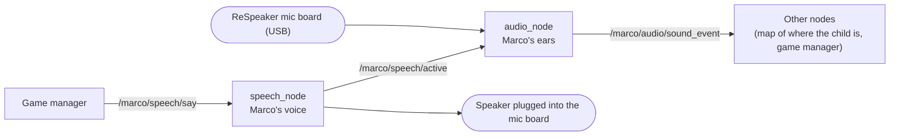

# Marco audio on the robot's computer: run sheet

Marco is a robot that plays hide and seek with a child (Team Jaffa, Human-Centred Robotics,
Imperial College London, 2026). This folder, `marco_audio`, is Marco's hearing and his voice.

This sheet shows how to run them on the robot's computer, one command at a time, with what you
should see after each. It is written for someone who has not worked on the project: a new team
member, a marker, or a future group picking the work up. Nothing here needs remembering, and no
earlier knowledge of the robot is assumed.

Responsible for this part of Marco: Ahmad Wahab (microphones, direction finding, keyword
spotting and voice playback).

## What it does

- **Hears where a sound came from.** A board with four microphones listens all the time. For every
  sound (a clap, a shout, a word) the software works out the direction it came from, how far to
  trust that direction, and how loud it was.
- **Hears the two game words.** It can tell whether the sound was the word "marco" or "polo".
- **Speaks.** It plays one of Marco's voice clips when another part of the robot asks for it.
- **Tells the rest of the robot.** Everything above is sent as ROS 2 messages, so the other
  parts of Marco (the map of where the child might be, the game logic) can use it.



The two boxes in the middle are the programs this sheet starts. The labels on the arrows are the
names of the channels they use to talk to the rest of the robot.

## What you need

| Thing | Details |
|---|---|
| The robot's computer | An NVIDIA Jetson Orin Nano developer kit, or any computer running Ubuntu 22.04 with ROS 2 Humble. The commands are the same on both |
| The microphone board | Seeed ReSpeaker XVF3800 USB 4-mic array, running the 16 kHz, 6-channel firmware (version 2.1.1). Sections 2 and 3 of [`../README.md`](../README.md) show how to check and change the firmware |
| Something to hear Marco with | A speaker or earphones plugged into the **board's** 3.5 mm socket |
| A way to type commands | A laptop on the same network as the robot's computer (this sheet assumes that), or a keyboard and screen plugged into the robot's computer |
| A login | A user name and password for the robot's computer. On Team Jaffa's Jetson the user is `jaffa`. The password is not in this repository: ask the team |
| Internet, the first time only | The first-time set-up (section 10) downloads software |

## Words used in this sheet

| Word | Meaning |
|---|---|
| Terminal, or window | A window where you type commands. PowerShell on Windows, Terminal on macOS or Linux |
| `ssh` | A command that logs your terminal in to another computer, so that what you type runs there |
| ROS 2 | The software the robot's parts use to talk to each other. This project uses the version called Humble |
| Node | One running program in ROS 2. Here: `audio_node` (ears) and `speech_node` (voice) |
| Topic | A named channel that nodes send messages on, such as `/marco/audio/sound_event` |
| Message | One item sent on a topic, with fixed fields. Here: one `SoundEvent` per sound |
| Launch file | A file that starts several nodes with one command |
| ROS domain | A channel number for the whole of ROS 2. Nodes with different numbers cannot hear each other |
| Azimuth | The direction of a sound, as an angle measured flat around the board |
| dBFS | A loudness scale. 0 is the loudest the board can measure, and quieter sounds are more negative |
| Replay | Playing a saved recording through the same software instead of the live microphone |

## The two windows

You work in two terminal windows. Every command below is labelled with the window it goes in.

| Name | What it is for |
|---|---|
| **Window 1** | runs Marco's ears and voice. It stays busy while they are running |
| **Window 2** | checks on them while Window 1 is busy |

Both start as ordinary windows on your own computer. After you log in (section 1), the start of
the line changes to the robot's computer, for example `jaffa@jetson`, and everything typed there
runs on the robot's computer. Look at the start of the line whenever you are unsure which
computer a window is talking to.

If you are sitting at the robot's computer with a keyboard and screen, open two terminals there
and skip section 1.

In the commands, replace `<user>` with the user name and `<address>` with the network address of
the robot's computer (section 1 shows how to find it).

## Quick reference: the commands used most

These assume the software is already installed and built (sections 3 and 10). Each step is
explained further down.

**Window 1 and Window 2**, once each, to log in:

```
ssh <user>@<address>
```

**Window 1 and Window 2**, once each, after logging in:

```
cd ~/marco_ws
source /opt/ros/humble/setup.bash
source install/setup.bash
```

Testing on your own, without the rest of the robot's nodes? Then also, in **Window 1 and Window 2**:

```
export ROS_DOMAIN_ID=42
```

**Start Marco listening** (this also gets his voice ready). **Window 1:**

```
ros2 launch marco_audio marco_audio.launch.py
```

Wait for the `Listening.` line. Stop with Ctrl+C in Window 1.

**Watch what Marco hears**, as the messages the other nodes receive. **Window 2:**

```
ros2 topic echo /marco/audio/sound_event
```

Stop with Ctrl+C in Window 2.

**Make Marco speak.** Window 1 must be running. The clips are placeholder beeps for now.

**Window 2**, say "Marco" (two notes going up):

```
ros2 topic pub --once /marco/speech/say std_msgs/msg/String "{data: marco}"
```

**Window 2**, say "Polo" (two notes going down):

```
ros2 topic pub --once /marco/speech/say std_msgs/msg/String "{data: polo}"
```

**Window 2**, say "Found you" (three quick notes going up):

```
ros2 topic pub --once /marco/speech/say std_msgs/msg/String "{data: found_you}"
```

**Window 2**, say "Sleepy" (one long note sliding down):

```
ros2 topic pub --once /marco/speech/say std_msgs/msg/String "{data: sleepy}"
```

**Fallback if the microphone misbehaves:** a saved clap test instead of the live board. **Window 1:**

```
ros2 launch marco_audio marco_audio.launch.py source:=replay
```

**Shut the robot's computer down**, only if nobody else is using it. **Window 1:**

```
sudo shutdown now
```

## 0. Before you start

- The robot's computer is switched on. On the Jetson, a green light next to its USB-C port shows
  it has power.
- It is on the same network as your laptop (section 1 has a tip about this).
- The mic board is plugged into one of its USB sockets. The board lies flat, logo up, with
  nothing covering it.
- A speaker or earphones are in the **board's** 3.5 mm socket, not the computer's.
- You have a user name and password for the robot's computer.

If other people share the robot's computer, keep to these rules. This software lives in
`~/marco_ws` only. Never run `apt upgrade`. Never edit `~/.bashrc`. Do not start anything heavy
while someone is drive-testing the robot.

## 1. Connect

**Window 1:**

```
ssh <user>@<address>
```

Type `yes` if it asks whether to continue, then the password. Nothing shows while you type the
password. You are in when the start of the line changes to the robot's computer, for example
`jaffa@jetson`.

Finding the address, any one of:

- On the robot's computer itself (keyboard and screen, or someone who is already logged in), run
  `hostname -I`. The first number it prints is the address.
- If both computers are on a phone hotspot, look at the phone's list of connected devices.
- On a Jetson, plug a USB cable from its USB-C port into your laptop and run this in a window that
  is **not** logged in:

  ```
  ssh <user>@192.168.55.1 "hostname -I"
  ```

  A Jetson with its standard software answers on `192.168.55.1` over that cable. The link can
  drop out on Windows, so
  repeat the command a few times if it fails. It only has to hold for a few seconds. Then
  unplug the cable and use the address it printed.

Tip: a university Wi-Fi that needs a personal login may not reconnect by itself after the
robot's computer is restarted. A phone hotspot that both the robot's computer and your laptop
join is the simplest network to work on.

## 2. Set up the window

**Window 1:**

```
cd ~/marco_ws
source /opt/ros/humble/setup.bash
source install/setup.bash
```

These lines tell the window where ROS 2 and this project's two packages are. They print
nothing. A window that has not run them does not know the `ros2` command or the `marco_audio`
package. Window 2 gets the same lines in section 5.

Then choose one:

- **Running with the rest of the robot's nodes:** nothing more. You share their ROS domain.
- **Testing on your own:** one more line.

  **Window 1:**

  ```
  export ROS_DOMAIN_ID=42
  ```

  A domain is like a radio channel: nodes on different numbers cannot hear each other, so your
  test stays private. The setting lasts only until that window is closed. Window 2 needs the
  same line (section 5), or the two windows cannot hear each other.

## 3. Get the latest code and build

Do this once per session, and again after anyone changes the code on GitHub. It changes files on
the robot computer's disk, which both windows share, so it only needs doing in one window.

**Window 1:**

```
cd ~/marco_ws/src/jaffa
git pull
cd ~/marco_ws
colcon build --symlink-install
source install/setup.bash
```

- `git pull` fetches the newest version of the project from GitHub.
- `colcon build` is ROS 2's build tool. It turns the source folders into something the `ros2`
  command can run.

You should see `Already up to date.` or a list of changed files, then
`Summary: 2 packages finished`.

If `~/marco_ws` does not exist yet, do the first-time set-up in section 10 first.

## 4. Start Marco's ears and voice

**Window 1:**

```
ros2 launch marco_audio marco_audio.launch.py
```

Stay quiet for the first few seconds: the software is measuring the room's background noise.
Window 1 should show these lines, among others:

1. `Marco audio: ears = live, keywords = auto, voice = on, mic_array_link is ...`
2. `[mic_array_tf]: Spinning until stopped - publishing transform` and `from 'base_link' to 'mic_array_link'`
3. `[speech_node]: Ready. Player: aplay -q -D plughw:CARD=Array,DEV=0. Clips in ...: found_you, marco, polo, sleepy.`
4. `[audio_node]: Keyword spotting is on: listening for marco, polo on channel 1 ...`
   (or `Keyword spotting is off ...` if the speech recogniser is not installed: section 10)
5. `[audio_node]: Listening to device <number>: reSpeaker XVF3800 4-Mic Array ...` then `Background -9x dBFS ... Listening.`

After the `Listening.` line, every sound gives one line in Window 1. Clap once, about 1 m from
the board:

```
#1:   +2.0 deg  (+-1.4)  confidence 1.00  level -52 dBFS
```

Say "Polo!" clearly from the same place, and the line ends with the word:

```
#2:   +3.1 deg  (+-2.0)  confidence 0.93  level -48 dBFS  keyword POLO (0.97)
```

**How to read a line**

| Part | Meaning |
|---|---|
| `+2.0 deg` | The direction the sound came from. 0 is straight out of the board's USB edge. Positive angles are anticlockwise seen from above (to the left) |
| `(+-1.4)` | How uncertain that direction is, in degrees |
| `confidence 1.00` | How far to trust the direction, from 0 to 1. Below 0.5 is doubtful |
| `level -52 dBFS` | How loud the sound was at the microphones |
| `[inconsistent]`, `[drop mic 3]` | The four microphones did not agree. The direction is doubtful or was worked out without one microphone |
| `keyword POLO (0.97)` | The word that was heard, and how sure the speech recogniser is of it, from 0 to 1 |
| `(heard polo 0.41: not counted)` | The word was heard, but the recogniser was not sure enough to count it |

With keyword spotting on, each line appears about a second after its sound, because the
recogniser has to hear the whole word first. In a room where people are talking, expect a steady
stream of lines with low confidence: that is the room, not a fault (section 7 shows how to hide
them).

Window 1 is now busy. Leave it running and do the checks in Window 2. To stop everything, press
**Ctrl+C** in Window 1.

**Once the board is mounted on the robot**, say where it is. Measure from `base_link` (the
robot's own reference point: on Team Jaffa's Pioneer 3-AT, the centre of the robot at axle
height) to the centre of the board, in metres, and start it with this instead of the command
above. The four numbers here are only an example: change them to your own measurements.

**Window 1:**

```
ros2 launch marco_audio marco_audio.launch.py mic_x:=0.10 mic_y:=0.0 mic_z:=0.25 mic_yaw_deg:=0
```

`mic_x` = forward, `mic_y` = left, `mic_z` = up, `mic_yaw_deg` = which way the board's USB edge
points (0 = the robot's front, 90 = its left, 180 = its back, -90 = its right).

`mic_z` is measured from `base_link`, not from the floor. On the Pioneer 3-AT `base_link` is
about 0.11 m above the floor (confirm the figure with whoever set up navigation), so
`mic_z` = the board's height above the floor minus 0.11.

Worked example: the board is on top of the robot at the very front, 0.30 m ahead of the centre,
in the middle of the robot's width, 0.40 m above the floor, with its USB edge pointing forwards.
Then `mic_x` = 0.30, `mic_y` = 0, `mic_z` = 0.40 - 0.11 = 0.29 and `mic_yaw_deg` = 0.

**Window 1:**

```
ros2 launch marco_audio marco_audio.launch.py mic_x:=0.30 mic_y:=0.0 mic_z:=0.29 mic_yaw_deg:=0
```

`mic_yaw_deg` is the one that has to be right: an error there turns every direction by the same
amount. `mic_x` and `mic_y` to the nearest few centimetres are enough, and `mic_z` hardly changes
a direction at all.

## 5. Check it from Window 2

Leave Window 1 running. First log Window 2 in and set it up.

**Window 2:**

```
ssh <user>@<address>
```

**Window 2**, once it is logged in:

```
cd ~/marco_ws
source /opt/ros/humble/setup.bash
source install/setup.bash
```

**Window 2**, only if you ran it in Window 1 (testing on your own):

```
export ROS_DOMAIN_ID=42
```

Now the four checks.

**Window 2:**

```
ros2 topic list | grep marco
```

Window 2 shows `/marco/audio/sound_event`, `/marco/speech/active` and `/marco/speech/say`.

**Window 2:**

```
ros2 topic echo /marco/audio/sound_event
```

Clap once. Window 2 prints one message per sound: look for `frame_id: mic_array_link`, `azimuth`,
`confidence` and `method: gcc_phat_robust`. Say "Polo!" and the message shows `type: keyword` and
`keyword: polo`. Window 1 prints its usual line for the same sound. Press Ctrl+C in Window 2 to
stop the echo (not in Window 1).

**Window 2:**

```
ros2 topic pub --once /marco/speech/say std_msgs/msg/String "{data: marco}"
```

You hear the clip called marco (also: `polo`, `found_you`, `sleepy`). Window 1 prints
`Saying 'marco'`. This command stands in for the robot's game manager, which sends the same
message when Marco should speak.

**Window 2:**

```
ros2 run tf2_ros tf2_echo base_link mic_array_link
```

Window 2 prints the board's position and rotation on the robot, once a second. Press Ctrl+C in
Window 2 to stop it.

## 6. Fallback: no board, or the live microphone misbehaves

Press Ctrl+C in Window 1 to stop the live version, then:

**Window 1:**

```
ros2 launch marco_audio marco_audio.launch.py source:=replay
```

This plays a saved clap test (recorded on 28 Oct 2026, 24 claps from 8 directions) through the
same code, over and over. The other nodes cannot tell the difference. The first three sounds are
always `-3.8`, `-3.9` and `-2.1 deg`. The checks in section 5 work the same way in Window 2.

## 7. Settings worth knowing

They go on the end of the launch command in Window 1, as `name:=value`. Adding `--show-args`
instead lists all of them.

| Setting | Default | What it does |
|---|---|---|
| `source` | `live` | `replay` = play a saved run instead of the microphone |
| `min_confidence` | `0.0` | `min_confidence:=0.5` hides sounds with a doubtful direction. Useful in a noisy room. A "marco" or "polo" is still shown |
| `min_db` | `0` (= -70) | sounds quieter than this (dBFS) are ignored. `min_db:=-80` hears quieter sounds |
| `method` | `gcc_phat_robust` | how the direction is worked out. Or `gcc_phat`, `srp_phat` (explained in the README) |
| `speech` | `true` | `false` = ears only |
| `keywords` | `auto` | `auto` = spot "marco" / "polo" if the speech recogniser is installed. `false` = directions only. `true` = stop with an error if it is missing |
| `kws_min_conf` | `0.6` | a word the recogniser is less sure of than this is not counted. `kws_min_conf:=0.4` catches more words and makes more mistakes |
| `publish_tf` | `true` | `false` if another node already publishes `base_link -> mic_array_link` |
| `mic_x` `mic_y` `mic_z` `mic_yaw_deg` | `0` | where the board is on the robot (section 4) |
| `sound_topic` | `/marco/audio/sound_event` | publish the sounds somewhere else |

## 8. If something goes wrong

"Launch again" means: Ctrl+C in Window 1, then the launch command of section 4 in Window 1.
Any other command in this table goes in Window 2.

| What you see | Why | What to do |
|---|---|---|
| `ssh: ... Connection timed out` | wrong address, or the two computers are on different networks | find the address again (section 1) |
| `ssh: ... Connection refused` | the robot's computer is still starting up | wait 30 seconds and try again |
| `Connection reset` right after the password | the password took too long to type | run `ssh` again and type the password straight away |
| `ros2: command not found`, or `Package 'marco_audio' not found` | that window has not run section 2 | run the three lines of section 2 in that window |
| `No sound device with 6 or more inputs matches ...` and a list (Window 1) | the computer does not see the board, or the board has the wrong firmware | `lsusb` should show `2886:001a ... reSpeaker XVF3800`. Unplug and replug the board, launch again. If it is listed with fewer than 6 inputs, flash the 6-channel firmware (README, section 3) |
| `No audio has arrived from the board for 2 s` (Window 1) | the cable was knocked | replug the board, launch again |
| `No module named 'sounddevice'` (Window 1) | the first-time set-up was not done for this user | section 10 |
| claps give no line in Window 1 | quieter than -70 dBFS, or not 20 dB above the room's noise | clap closer, or launch again with `min_db:=-80` on the end |
| many `[inconsistent]` lines or low confidence | echoes (board covered, or right next to a wall) or a noisy room | keep the board in the open, 30 cm or more from walls; launch again with `min_confidence:=0.5` on the end |
| `Keyword spotting is off ...` (Window 1) | the speech recogniser or its model is not installed for this user | section 10, the keyword spotter part. The directions work without it |
| "Polo!" gives a line with no keyword | too quiet, too far, or said while someone else was talking | say it louder and alone; look for `(heard polo ...: not counted)` and, if it shows, launch again with `kws_min_conf:=0.4` on the end |
| other words are reported as `POLO` or `MARCO` | words that sound alike ("hello", "marker") can fool it | launch again with `kws_min_conf:=0.8` on the end, or `keywords:=false` to switch it off |
| the voice is too quiet or too loud | the board's playback volume | `amixer -c Array sset 'PCM',0 55` then `amixer -c Array sset 'PCM',1 55` (scale 0 to 60) |
| no voice at all | plugged into the wrong socket | the plug goes in the board's socket; the `Ready. Player:` line in Window 1 must say `CARD=Array` |
| `ros2 topic echo` prints nothing in Window 2 | the two windows are on different ROS domains | the same `export ROS_DOMAIN_ID=...` line in both windows, or in neither |
| `git pull` or `git clone` stops moving | the network stalled | Ctrl+C in that window and run it again |

## 9. Stop, and shut down

Press Ctrl+C in Window 1 to stop Marco's ears and voice. That is all that is needed if other
people are still using the robot's computer.

To switch the computer off as well, check nobody else is using it, then:

**Window 1:**

```
sudo shutdown now
```

Both windows lose their connection, which is expected. Wait for the Jetson's green light to go
out (about 15 seconds) before switching off at the wall. Never pull the plug while it is
running: that can damage the storage.

## 10. First-time set-up on a new computer

Only needed once per computer and user, or after the computer has been wiped. It needs Ubuntu
22.04 with ROS 2 Humble already installed. To check, this must print the file's name and not an
error:

**Window 1:**

```
ls /opt/ros/humble/setup.bash
```

If it is missing, install ROS 2 Humble first, following the official guide at
<https://docs.ros.org/en/humble/Installation/Ubuntu-Install-Debs.html> (the packages
`ros-humble-ros-base` and `ros-dev-tools` are enough).

**The ears and the voice.** This adds a few small packages and one Python library. The first
line only refreshes the list of available packages, and `--no-upgrade` means nothing that is
already installed gets changed.

**Window 1:**

```
sudo apt-get update
sudo apt-get install -y --no-upgrade python3-numpy python3-scipy python3-matplotlib alsa-utils libportaudio2 python3-cffi python3-pip python3-requests
python3 -m pip install --user --no-deps sounddevice
mkdir -p ~/marco_ws/src
cd ~/marco_ws/src
git clone https://github.com/luqeei1/jaffa.git
cd ~/marco_ws
source /opt/ros/humble/setup.bash
colcon build --symlink-install
```

It should end with `Summary: 2 packages finished`.

Then check that the computer sees the board with all six channels.

**Window 1:**

```
python3 -c "import sounddevice as sd; print(sd.query_devices())"
```

One line must read `reSpeaker XVF3800 4-Mic Array: USB Audio (hw:...), ALSA (6 in, 2 out)`.

**The keyword spotter** (the words "marco" and "polo") needs the Vosk speech recogniser and its
model: three small Python libraries for this user and one 40 MB folder in `~/marco_ws/models`.
Without them everything else still works, and the `keyword` field of the messages stays empty.

**Window 1:**

```
python3 -m pip install --user --no-deps vosk srt tqdm
mkdir -p ~/marco_ws/models
cd ~/marco_ws/models
wget https://alphacephei.com/vosk/models/vosk-model-small-en-us-0.15.zip
python3 -m zipfile -e vosk-model-small-en-us-0.15.zip .
ls vosk-model-small-en-us-0.15
```

The last line must print `README  am  conf  graph  ivector`.

Then check the recogniser starts and knows both words.

**Window 1** (one long line, copy all of it):

```
python3 -c "import vosk, json, os; m = vosk.Model(os.path.expanduser('~/marco_ws/models/vosk-model-small-en-us-0.15')); vosk.KaldiRecognizer(m, 16000, json.dumps(['marco', 'polo', '[unk]'])); print('RECOGNISER READY')"
```

It prints a screen of lines starting with `LOG`, then `RECOGNISER READY`.

Then carry on from section 2.

Two things to know about other computers:

- **A Windows laptop with WSL2** (Ubuntu inside Windows) can build the packages and run the
  replay of section 6, which is useful for development. It cannot see the USB mic board, so the
  live microphone needs a real Ubuntu computer such as the Jetson.
- **With WSL2's standard network settings, ROS 2 messages do not travel between the laptop and
  the robot's computer.** That is why this sheet runs every check in a window that is logged in
  to the robot's computer.

---

# Interface: what the audio nodes give the rest of Marco

This part is for anyone writing a node that uses Marco's hearing or voice.

| Topic | Type | Direction | Meaning |
|---|---|---|---|
| `/marco/audio/sound_event` | `marco_audio_msgs/msg/SoundEvent` | audio_node publishes | one message per sound heard |
| `/marco/speech/say` | `std_msgs/msg/String` | speech_node listens | the name of a clip to play: `marco`, `polo`, `found_you`, `sleepy` |
| `/marco/speech/active` | `std_msgs/msg/Bool` | speech_node publishes | `true` from just before a clip starts until it ends; repeated every 0.5 s |
| transform `base_link -> mic_array_link` | static | the launch file publishes | where the board is on the robot |

**SoundEvent**

| Field | Type | Meaning |
|---|---|---|
| `header.stamp` | time | when the sound started |
| `header.frame_id` | string | the frame the angle is measured in: `mic_array_link` |
| `azimuth` | float32 | direction the sound came from, radians, -pi to pi. 0 = straight ahead (+x), positive = anticlockwise seen from above, so +pi/2 is to the left (the ROS convention, REP 103) |
| `azimuth_std` | float32 | one-sigma uncertainty of `azimuth`, radians. pi = direction unknown |
| `confidence` | float32 | 0 (do not trust) to 1 (trust). Below 0.5 is doubtful |
| `level_db` | float32 | loudness in dBFS: 0 is the loudest the board can measure, a clap at 1 m is about -40 |
| `method` | string | how the direction was worked out: `gcc_phat`, `gcc_phat_robust` or `srp_phat` |
| `type` | string | `keyword` if the sound was one of the game words, otherwise `sound` |
| `keyword` | string | `marco` or `polo`, or empty if it was neither (always empty when the keyword spotter is off) |

**Using it in another node (Python)**

```python
from marco_audio_msgs.msg import SoundEvent

self.create_subscription(SoundEvent, "/marco/audio/sound_event", self.on_sound, 10)

def on_sound(self, msg):
    if msg.keyword == "polo":
        ...                         # somebody answered "Polo!"
    if msg.confidence < 0.5:
        return                      # doubtful direction: ignore it
    bearing = msg.azimuth           # radians, in the frame msg.header.frame_id
    spread = msg.azimuth_std        # radians, one sigma
```

The message type lives in the package `marco_audio_msgs`. A terminal can use it after
`source ~/marco_ws/install/setup.bash` (run it after sourcing your own workspace).

**Making Marco speak from another node (Python)**

```python
from std_msgs.msg import String

self.say = self.create_publisher(String, "/marco/speech/say", 10)
self.say.publish(String(data="marco"))      # plays clips/marco.wav
```

**Things to know**

- The angle is measured from the board, not from the map. Use the transform to turn it into a
  direction in `base_link` or `map`. If the board is mounted with its USB edge to the robot's
  front, the angle is already the angle from the robot's front.
- audio_node drops any sound that starts while `/marco/speech/active` is true (and for 0.3 s
  after), so Marco does not report his own voice.
- Sounds with a doubtful direction are still published, with a low `confidence`. Filter on it.
- With the keyword spotter on, a message goes out about 1 s after its sound started, because
  the whole word has to be heard first. `header.stamp` is still the moment the sound started,
  so use the stamp, not the arrival time.
- `keyword` says what the recogniser heard, `confidence` says how good the direction is. They
  are separate: a clear "polo" can come with a doubtful direction. A "marco" or "polo" is
  published even when its direction is below `min_confidence`.
- The recogniser only knows two words, so a word that sounds like one of them ("hello",
  "marker") can be reported as it. Treat `polo` as "probably polo", most of all outside the
  seconds after Marco has called out.
- Marco's voice must come out through the mic board (its speaker socket or 3.5 mm socket). The
  board can only cancel the echo of sound that it played itself.

---

# What has been tested, and what has not

| Part | State |
|---|---|
| Direction of a clap | Measured in three clap tests at 1 m, 24 claps each. In the live test of 5 Nov 2026 the typical error was 1.0 degrees and the worst 4.4 degrees. Method and results: README, sections 6 to 8 |
| Running on the Jetson | On Team Jaffa's Jetson Orin Nano (Ubuntu 22.04, ROS 2 Humble), 11 Nov 2026: the replay gave the same 24 answers as on a laptop, and the live microphone and the voice clips worked |
| The words "marco" and "polo" | Added on 12 Nov 2026. Checked so far: silence, hiss and the 24 recorded claps are not reported as words. Not measured yet: how many spoken "Polo!"s it catches, and how often other speech is mistaken for one |
| Direction of a spoken word | Not measured yet. A voice starts more softly than a clap, so expect lower confidence than for claps |
| Marco's voice | The four clips are placeholder beeps until the real voice is recorded |

# Where to read more

- [`../README.md`](../README.md): how the direction finding works, every test and its results, the
  stand-alone scripts, the firmware, and the checks that need no robot (`test/`).
- `../marco_audio/audio_node.py` and `../marco_audio/speech_node.py`: each node lists all of its
  settings at the top of the file.
- `../tools/keyword_spotter.py`: how a word is recognised and which rules decide whether it counts.
- `../launch/marco_audio.launch.py`: every launch setting, with its default.
