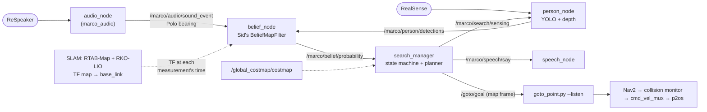

# marco_search: the integration demo loop

This package joins the sensor stack to the navigation stack. Marco stops at least every 5 s, calls
"Marco", looks with the RGB-D camera and listens for "Polo". He then updates the belief map of
where the child is, picks the next point to drive to and sends it to Nav2. He stops when the camera
sees a person close in front of him and says "found you".

The fusion maths is Sid's `sensor_fusion/sensor_fusion.py`, imported unchanged: its
`BeliefMapFilter`, `visual_likelihood` and `audio_likelihood`. The Polo adapter is
`sensor_fusion/marco_audio_bridge.py:sound_observation`. The person detector is `rgbd/core`
(YOLO plus aligned depth). The ears and voice are `marco_audio`. Navigation is `p3at_real`
(`goto_point.py`, Nav2, collision monitor, `cmd_vel_mux`).



## One search cycle

| Phase | What happens | Default length |
|---|---|---|
| `SENSE/settle` | The goal is cancelled and the robot comes to rest | 0.8 s |
| `SENSE/call` | The camera detector switches on and Marco says "Marco" | the 0.7 s clip |
| `SENSE/listen` | The child has time to answer, plus the keyword spotter's delay | 3.0 + 1.3 s |
| `SENSE/update` | The camera switches off and the belief map applies this stop's evidence | under 2 s |
| `MOVE` | The planner's goal goes to Nav2, and the robot drives until it arrives or 5 s pass | at most 5 s |

The cycle then repeats. A person close in front of the camera gives `FOUND`, in any phase. An
e-stop gives `PAUSED`.

Evidence is applied once per stop, so the same measurement is never multiplied in twice:

- **Polo bearing.** It is applied when it arrives, if the sound started while the robot was sensing.
  The microphone pose comes from TF at the sound's own timestamp.
- **Camera.** When the stop ends, the frame with the most confident people is applied as one update.
  If nobody was seen, the belief inside the camera's view is halved ("nobody here"). Without that
  step the map would keep pointing at a spot that has already been checked.

The planner reads the whole belief map, not just its peak:

| Mode | When | Goal |
|---|---|---|
| `explore` | The belief is spread out, for example after one bearing | 1.5 m towards the direction holding the most belief. The next bearing, from a new spot, crosses the first one |
| `approach` | At least 25 % of the belief lies within 0.75 m of the peak | 1.0 m short of the peak, facing it |
| `look` | Near the peak but not facing it | A short step that turns the camera onto it |
| `scan` | No evidence yet, or at the peak with nobody seen | Turn 60° and creep 0.5 m |

Every goal is moved to the nearest cell that the Nav2 global costmap says the robot can stand in.

## Before the demo

1. **Measure the sensor mounts.** Measure them from `base_link`, the robot centre at axle height,
   in metres, with x forward, y left and z up. Pass them to the launch file. The defaults
   (camera 0.20, 0, 0.45 and microphone 0.15, 0, 0.25) are only placeholders. A wrong yaw sends
   the robot the wrong way.
2. **Vosk.** For "Polo" to be recognised, Vosk and its model must be installed (marco_audio run
   sheet, section 10). Without it, launch with `any_sound:=true`, so that any sound with a
   direction counts as Polo.
3. **Camera.** The camera needs `pyrealsense2`, `ultralytics` and `opencv` for the Jetson's Python
   (`rgbd/requirements.txt`). It also needs YOLO weights. The node looks for `rgbd/scripts/yolo26n.pt`,
   then `~/marco_ws/models/yolo26n.pt`. If neither exists, Ultralytics downloads the weights, which
   needs internet.
4. **Foxglove.** Install the bridge once with `sudo apt install ros-humble-foxglove-bridge`.
5. **Build.** Build in `~/marco_ws`, where the repo is cloned into `src/jaffa`:

   ```bash
   cd ~/marco_ws && source /opt/ros/humble/setup.bash
   colcon build --symlink-install --packages-up-to marco_search marco_audio
   ```

   SLAM and Nav2 keep their own workspace in `slam/` (see `slam/README.md`).

## Run it on the robot

Every terminal sources both workspaces. `REPO` is wherever the jaffa repo is cloned on the
Jetson, normally `~/marco_ws/src/jaffa`:

```bash
REPO=~/marco_ws/src/jaffa
source /opt/ros/humble/setup.bash
source $REPO/slam/install/setup.bash    # p3at_real: SLAM, Nav2, goto_point.py
source ~/marco_ws/install/setup.bash    # marco_audio, marco_search
```

```bash
# Terminal 1: robot, lidar, odometry, SLAM and the run bag. Keep the robot still until
# RKO-LIO prints "Odometry map frame initialized".
ros2 run p3at_real run_slam.sh demo

# Terminal 2: Nav2, once RTAB-Map is running.
ros2 launch p3at_real nav.launch.py

# Terminal 3: ears, voice, camera, belief map, search loop, goto_point and the Foxglove bridge.
ros2 launch marco_search search_demo.launch.py cam_x:=0.20 cam_z:=0.45 mic_x:=0.15 mic_z:=0.25 mic_yaw_deg:=0

# Start the search (or press "Start search" in Foxglove).
ros2 topic pub --once /marco/search/command std_msgs/msg/String "{data: start}"
```

| Command on `/marco/search/command` | Effect |
|---|---|
| `start` | Starts a new round, which resets the belief map. From `PAUSED` it resumes instead |
| `stop` | Cancels the goal and goes to `IDLE` |
| `pause` | Cancels the goal and waits for `start` |
| `reset` | Clears the belief map only |

**Safety.** The e-stop works as before: **E** in the teleop window, or
`ros2 topic pub -w 1 --once /estop std_msgs/msg/Bool "{data: true}"`. The search goes to `PAUSED`
and does not resume on its own: release the e-stop, then send `start`. Teleop still overrides Nav2
at any time. `stop` is not an e-stop. The physical stop is the last resort.

**Found.** `FOUND` fires for any person within 1.6 m in front of the camera, for two frames in a row.
Keep the audience out of the camera's way, or lower `search.found_distance_m`.

Stop everything with Ctrl-C in each terminal, then `ros2 run p3at_real stop_all.sh`. That script
now also stops the marco_search and marco_audio nodes.

## See what it is doing (Foxglove)

1. Connect Foxglove to `ws://<jetson-ip>:8765` with "Open connection" and "Foxglove WebSocket".
2. Import the layout `marco_search/foxglove/marco_search_layout.json` (Layouts, then Import from file).

| Panel | Shows |
|---|---|
| 3D | The SLAM `/map`, the belief heat map in red, the Polo bearing and its ±1σ lines in blue, people the camera saw in green, the camera's view (yellow = nobody seen), the belief peak and its label, the goal and the Nav2 plan, and a phase label above the robot. Clicking a point publishes it on `/goto/goal`, which is a manual goal |
| Image | The camera frame with YOLO boxes while sensing (green = has depth, orange = no depth) |
| Diagnostics tab | One row each for the search state (why it is doing what it does), the belief map (what it believes, and from which evidence), and the health of each input, each marked OK, WARN or ERROR |
| State Transitions | A timeline of the search phase, sensing, Marco speaking and who drives (`cmd_vel_mux`) |
| Plot | Belief peak relative to uniform, and entropy, over time |
| Log | Every decision line from `/rosout` |
| Buttons | Start search, Stop, Reset belief |

Without Foxglove, the same information is in the terminal and in these commands:

```bash
ros2 topic echo /marco/search/events      # one line per decision
ros2 topic echo /marco/search/state       # JSON: phase, reason, goal, health of every input
ros2 topic echo /marco/belief/summary     # JSON: peak, concentration, last Polo, last camera
```

`run_slam.sh`'s bag now also records the search, belief and goto topics (`slam/runs/<run>/bag`).

## Dry run without the robot

`sim_world` stands in for the robot, goto_point, Nav2's costmap, speech_node and a child who
answers Polo. Never start it while the real robot stack is running.

```bash
ros2 launch marco_search search_demo.launch.py sim:=true autostart:=true child_x:=6.3 child_y:=2.8
```

On a laptop, three runs each ended in `FOUND`. With the child behind the robot at (-1, 2.5), it took
two cycles. With the child 6.9 m away at (6.3, 2.8), it took two explore steps along the bearing,
then the camera saw the child, two approach legs followed, and the child was found 1.0 m away.

## Topics

| Topic | Type | From | Meaning |
|---|---|---|---|
| `/marco/search/command` | String | operator | start, stop, pause, reset |
| `/marco/search/phase` | String, latched | search_manager | IDLE, SENSE/settle, SENSE/call, SENSE/listen, SENSE/update, MOVE, FOUND, PAUSED |
| `/marco/search/state` | String JSON, latched | search_manager | phase, reason, cycle, goal, last plan, health |
| `/marco/search/events` | String | search_manager | decision log |
| `/marco/search/sensing` | Bool, latched | search_manager | true while stopped to sense |
| `/marco/search/goal`, `/marco/search/markers` | PoseStamped, MarkerArray | search_manager | goal and labels |
| `/diagnostics` | DiagnosticArray | search_manager | search, belief and health rows |
| `/goto/goal`, `/goto/cancel` | PointStamped, Empty | search_manager | goal for goto_point.py, in the map frame |
| `/marco/speech/say` | String | search_manager | "marco", "found_you" |
| `/marco/belief/probability` | marco_search_msgs/BeliefGrid | belief_node | full-precision belief map, for the planner |
| `/marco/belief/grid` | OccupancyGrid | belief_node | the same map for viewing (100 = 20x uniform) |
| `/marco/belief/estimate` | PoseWithCovarianceStamped | belief_node | peak and local covariance |
| `/marco/belief/summary` | String JSON | belief_node | numbers and what the last update used |
| `/marco/belief/markers` | MarkerArray | belief_node | bearing, people, camera view, peak |
| `/marco/belief/reset` | Empty | anyone | uniform belief |
| `/marco/person/detections` | marco_search_msgs/PersonDetections | person_node | people in one frame, in the camera optical frame |
| `/marco/person/image/compressed` | CompressedImage | person_node | annotated frame |

TF needed: `map → odom → base_link` (SLAM), `base_link → mic_array_link` (marco_audio launch),
and `base_link → camera_link → camera_color_optical_frame` (this launch).

## Settings

All the settings are in `config/search_demo.yaml`, with a comment on each. The ones most likely
to need changing:

| Setting | Default | Why change it |
|---|---|---|
| `search.move_period_s` | 5.0 | Stops to sense more or less often |
| `search.listen_s` | 3.0 | Children who answer slowly |
| `search.found_distance_m` | 1.6 | Bystanders near the robot |
| `planner.standoff_m` | 1.0 | How close Marco drives to the believed position |
| `person_node.imgsz` / `device` | 640 / cpu | YOLO speed on the Jetson (480, or `"0"` for the GPU) |
| `belief_node.miss_p_detect` | 0.5 | How strongly "nobody seen" counts |
| `belief_node.accept_unclassified` | false | Launch argument `any_sound:=true` |

## Tests

```bash
cd $REPO/marco_search && python3 -m pytest -q test
```

These 23 checks cover Sid's grid on map-frame coordinates, Polo plus camera fusion, two-person
mixtures, the camera-miss evidence, all planner modes, free-space goal fixing and the state
machine's timing, failure handling, found and e-stop. They need no ROS nodes.

## Not done yet

- **Thermal is not in the loop.** Sid's `fuse_position_observations` (RGB-D and thermal gating) is
  ready, but no ROS node publishes thermal detections yet.
- **"Nobody seen" ignores walls.** The camera-miss evidence does not ray-trace, so a child hidden
  behind furniture is only made less likely, never ruled out.
- **Mount offsets and timings are untested on the robot.** The Polo bearing's TF timing, the
  YOLO rate on the Jetson and the mount offsets have only been exercised in `sim_world`.
