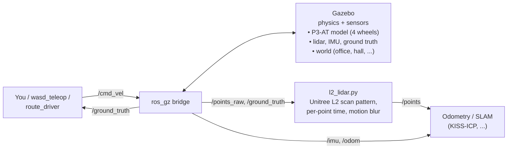

# How the simulator works

## The big picture
Four pieces of software, connected by **ROS 2 topics** (named message channels):


`route_driver` steers using `/ground_truth`. With manual teleop, you steer by watching Gazebo.

| Piece | What it does |
|---|---|
| **Gazebo Fortress** | Simulates physics (wheels, friction, ramps) and renders the lidar and IMU |
| **ros_gz bridge** | Translates between Gazebo topics and ROS 2 topics |
| **robot_state_publisher** | Publishes the robot's shape and where its sensors sit (TF) |
| **l2_lidar.py** | Makes Gazebo's lidar scan like a Unitree L2 |
| **Your code** | Anything that sends `/cmd_vel` or reads `/odom`, `/points`, `/imu` |

The topic names match the **real robot**, so code written against the sim runs on the real P3-AT unchanged.

## The robot model
Defined in `urdf/p3at.urdf.xacro` (URDF = robot description file; xacro = URDF with variables).

```
base_footprint            ground point under the robot
 └─ base_link             chassis box, 10 kg
     ├─ 4 wheels          r = 0.111 m, both wheels on a side are driven together (skid steer)
     └─ lidar_link        0.28 m up: Unitree L2 lidar (75 × 75 × 65 mm)
         └─ imu_link      the L2's built-in IMU, 200 Hz, with noise and bias
```
- **Driving:** Gazebo's `DiffDrive` plugin turns `/cmd_vel` (forward speed + turn rate) into wheel speeds.
  It also publishes **wheel odometry** on `/odom`.
- **Skid steer:** wheel friction and an *effective* track width (wider than the real one) reproduce how a
  4-wheel robot slips sideways when it turns.
- **Ground truth:** a plugin publishes the robot's *true* pose on `/ground_truth`. This is used for scoring only.

## Topics
| Topic | Type | From → to | Content |
|---|---|---|---|
| `/cmd_vel` | Twist | you → robot | speed command |
| `/odom` | Odometry | robot → you | wheel odometry (drifts, like the real thing) |
| `/points_raw` | PointCloud2 | Gazebo | raw lidar cloud |
| `/points` | PointCloud2 | l2_lidar | L2 cloud: `x y z intensity ring time` per point: **use this one** |
| `/imu` | Imu | Gazebo | gyro + accelerometer, 200 Hz |
| `/ground_truth` | Odometry | Gazebo | true pose in the `world` frame (scoring only) |
| `/tf`, `/joint_states`, `/clock` | | | frames, wheel angles, simulation time |

Frames: `odom → base_footprint → base_link → lidar_link → imu_link`, plus the wheels.
All nodes use **simulation time** (`use_sim_time: true`).

## The Unitree L2 lidar
Specs from [unitree.com/L2](https://www.unitree.com/L2/):

| Spec | L2 | In the sim |
|---|---|---|
| Field of view | 360° × 96° (hemisphere, plus 6° below the horizon) | same |
| Scan pattern | head turns at 5.55 Hz; mirror sweeps the beam over the top at 216 Hz | same timing, point by point |
| Point rate | 128,000 samples/s, ~64,000/s in view | same |
| Range | 0.05–30 m, accuracy ≤ 2 cm | same, 1 cm noise |
| IMU | built in, 0.8 cm from the lidar centre | same offset |

How it is made: Gazebo renders a **1° grid of rays** over the whole field of view at once. `l2_lidar.py`
then keeps only the rays the L2 would fire during that 0.1 s, gives each point its exact measurement time,
and (with `distort:=true`) shifts it to where the robot was at that moment, using ground truth.

What it looks like: each 0.1 s cloud is about **43 vertical arcs**, and they land somewhere new every
frame. Single frames are sparse. That's why the L2 is normally paired with an IMU-based LIO (Point-LIO).

## Worlds
Five indoor worlds. Each has hiding spots (under tables, behind shelves, closets, L-shaped walls), and each
tests a different weakness of lidar odometry:

| World | Size / feature | Tests |
|---|---|---|
| `office` | rooms around a central core | loop closure, doorways |
| `warehouse` | repeating shelf aisles | places that look the same |
| `corridor` | 50 m plain corridor | drift along a featureless direction |
| `hall` | 40 × 28 m sports hall | few, far-away returns |
| `split_level` | ramps up to a mezzanine | height (z) drift, tilting |

The worlds are **generated**: edit `scripts/gen_worlds.py` and re-run it. Never edit the `.sdf` files by hand.

## The testing pipeline
**Record once, replay into every method, score against ground truth.** Every method then sees identical data.

```
record_route.sh ─► bags/<world>_<tag>/                 robot follows a fixed route; sensors + truth saved
run_method.sh   ─► results/<world>_<tag>/<method>/     replay the bag into one method, save its path
evaluate.py     ─► metrics.json + results/summary.csv  compare that path with ground truth (evo)
build_map.py    ─► map_<method>.ply + plots            lidar map from each method's poses
benchmark.sh    ─► all of the above for every world and method, then summarize.py
```
- `route_driver.py` steers along the waypoints in `config/routes.yaml` using ground truth, so every recording follows the same route.
- Odometry methods are listed in `config/methods.yaml` (`wheel_odom`, `kiss_icp`, `kiss_icp_indoor`).
  To add one, give the command that launches it and its output topic.

## Known limits
- Software rendering on WSL, so the sim runs at ~0.4× real time. Bags use sim time, so results are unaffected.
- The L2 beams snap to a 1° grid of rays, and motion blur is **emulated** from ground truth, not rendered.
- The worlds have no ceilings, so upward beams return nothing (a real room gives more points).
- KISS-ICP (lidar only) drifts on the sparse L2 frames: ~0.9 m end error on a 4 m test drive.
- IMU noise is white noise plus a fixed bias (no slow bias drift).
- The robot uses simple shapes, not the real P3-AT meshes.
